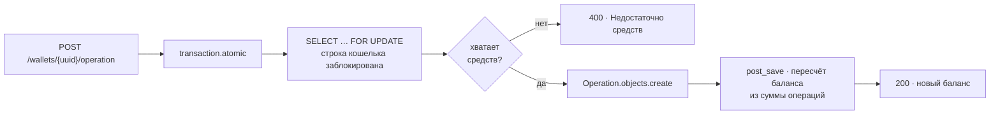

# Wallet

Кошелёк с тремя операциями — узнать баланс, пополнить, снять. Вся сложность
здесь в одном вопросе: что произойдёт, если по одному кошельку прилетит
пятьдесят запросов одновременно.

## Что происходит при параллельных запросах

Наивная реализация читает баланс, прибавляет сумму и сохраняет — и теряет
половину операций, потому что между чтением и записью успевает вклиниться
соседний запрос. Здесь этого не может случиться:



Запросы по одному кошельку выстраиваются в очередь на уровне БД — блокировка
строки живёт до конца транзакции, так что проверка средств и запись операции
происходят без чужого вмешательства. Кошельки разных пользователей друг друга
не ждут: блокируется строка, а не таблица.

Баланс при этом нигде не инкрементируется. Он пересчитывается из журнала
операций в сигнале `post_save` ([`wallets/signals.py`](backend/wallets/signals.py)),
поэтому история и баланс не могут разойтись: баланс — производная от истории,
а не отдельно хранимое мнение о ней.

Ещё пара решений в ту же сторону: деньги хранятся в `DecimalField`, а не во
`float`; проверка средств продублирована в `Operation.clean()`, чтобы операцию
в минус нельзя было создать из админки или shell; кошелёк адресуется UUID, а не
автоинкрементным id.

## Запуск

```bash
git clone https://github.com/SlavaKlkv/wallet.git
cd wallet
cp .env.example .env

docker compose up --build
```

Поднимутся PostgreSQL 17, Django под gunicorn и nginx на `:80`. Живость —
`GET /api/v1/health`. Для сервера есть
[`docker-compose.production.yml`](docker-compose.production.yml) — то же самое,
но с готовыми образами вместо локальной сборки.

Без Docker:

```bash
python -m venv venv && source venv/bin/activate
pip install -r backend/requirements.txt

python backend/manage.py migrate
python backend/manage.py runserver

pytest
```

С `USE_SQLITE=1` Postgres не нужен — удобно для быстрого прогона тестов.

## API

Префикс `/api/v1/`, авторизация — токен djoser
(`POST /api/v1/auth/token/login/`), кошелёк виден только владельцу.

| Метод | Путь | Что делает |
| --- | --- | --- |
| `GET` | `/wallets/{uuid}/` | баланс |
| `POST` | `/wallets/{uuid}/operation/` | `deposit` или `withdraw` |
| `GET` | `/health` | healthcheck |

```bash
curl -sX POST http://localhost/api/v1/wallets/$UUID/operation/ \
  -H "Authorization: Token $TOKEN" \
  -H 'Content-Type: application/json' \
  -d '{"operation_type": "deposit", "amount": 200}'
```

```json
{ "balance": 5450.37 }
```

Ошибки (400, 401, 403, 404) приходят единым форматом:
`{"detail": "Недостаточно средств."}`.

## Устройство

```
backend/
├── api/        эндпоинты и сериализаторы
├── wallets/    Wallet, Operation, пересчёт баланса
├── users/      пользователь с авторизацией по email
└── core/       константы, миксины, права, исключения
nginx/          прокси
tests/          pytest, покрыты все эндпоинты
```

Стек: Python 3.9, Django 4.2, DRF 3.16, PostgreSQL 17, pytest, Docker Compose.

## Переменные окружения

Полный список с примерами — в [`.env.example`](.env.example). Коротко о
неочевидных: `USE_SQLITE=1` переключает проект на SQLite; `DB_HOST` — это `db`
внутри Docker и `localhost` при локальном запуске; `MEDIA_ROOT` нужен только
вне локального окружения.

## Лицензия

MIT
