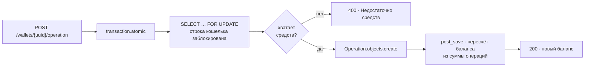

<div align="center">

# Wallet

**REST API кошелька: пополнение, снятие и баланс — устойчиво к параллельным запросам.**

Баланс не «подкручивается» инкрементом: он пересчитывается из журнала операций,
а строка кошелька на время операции блокируется в PostgreSQL. Одновременные
списания не могут увести баланс в минус и не затирают друг друга.

[](backend/requirements.txt)
[](backend/)
[](backend/api)
[](docker-compose.yml)
[](tests/)
[](#лицензия)

[Быстрый старт](#быстрый-старт) ·
[Как это устроено](#как-это-устроено) ·
[API](#api) ·
[Разработка](#разработка)

</div>

---

## Быстрый старт

```bash
git clone https://github.com/SlavaKlkv/wallet.git
cd wallet
cp .env.example .env      # см. таблицу переменных ниже

docker compose up --build
```

Поднимутся PostgreSQL, Django за Gunicorn и nginx. Проверка живости —
`GET /api/v1/health`.

Продакшен-конфигурация — [`docker-compose.production.yml`](docker-compose.production.yml):
те же сервисы, но с готовыми образами вместо локальной сборки.

---

## Как это устроено



Ключевые решения:

| Решение | Зачем |
| --- | --- |
| `select_for_update()` внутри `transaction.atomic()` | параллельные операции по одному кошельку выстраиваются в очередь на уровне БД, а не соревнуются в приложении |
| Баланс — производная от журнала операций | пересчёт в сигнале `post_save` ([`wallets/signals.py`](backend/wallets/signals.py)) исключает расхождение между историей и балансом |
| `DecimalField`, а не `float` | деньги не округляются «как получится» |
| Проверка средств и в сервисе, и в `Operation.clean()` | админка и shell не могут создать операцию, уводящую баланс в минус |
| Кошелёк адресуется UUID | внешний идентификатор не раскрывает число пользователей |

Структура:

```
backend/
├── api/        # эндпоинты, сериализаторы
├── wallets/    # модели Wallet и Operation, пересчёт баланса
├── users/      # пользователь с авторизацией по email
└── core/       # общие константы, миксины, права, исключения
nginx/          # прокси
tests/          # pytest, покрыты все эндпоинты
```

---

## API

Базовый префикс — `/api/v1/`. Авторизация — токен djoser
(`POST /api/v1/auth/token/login/`), кошелёк доступен только владельцу.

| Метод | Путь | Что делает |
| --- | --- | --- |
| `GET` | `/wallets/{uuid}/` | баланс кошелька |
| `POST` | `/wallets/{uuid}/operation/` | пополнение или снятие |
| `GET` | `/health` | healthcheck |

**Пополнить кошелёк**

```bash
curl -sX POST http://localhost/api/v1/wallets/$UUID/operation/ \
  -H "Authorization: Token $TOKEN" \
  -H 'Content-Type: application/json' \
  -d '{"operation_type": "deposit", "amount": 200}'
```

```json
{ "balance": 5450.37 }
```

`operation_type` — `deposit` или `withdraw`. Ошибки (400, 401, 403, 404)
возвращаются единым форматом:

```json
{ "detail": "Недостаточно средств." }
```

---

## Разработка

```bash
python -m venv venv && source venv/bin/activate
pip install -r backend/requirements.txt

python backend/manage.py migrate
python backend/manage.py runserver

pytest
```

С `USE_SQLITE=1` проект поднимается на SQLite — удобно для быстрого прогона
тестов без Postgres.

### Переменные окружения

| Переменная | Описание | Пример |
| --- | --- | --- |
| `SECRET_KEY` | секретный ключ Django | `your_secret_key` |
| `DEBUG` | режим отладки | `True` |
| `USE_SQLITE` | использовать SQLite вместо PostgreSQL | `0` |
| `CSRF_TRUSTED_ORIGINS` | доверенные домены, через запятую | `https://site-domen.com` |
| `POSTGRES_USER` | пользователь PostgreSQL | `postgres_user` |
| `POSTGRES_PASSWORD` | пароль PostgreSQL | `postgres_password` |
| `POSTGRES_DB` | имя базы | `db_name` |
| `DB_HOST` | хост БД (`db` — в Docker, `localhost` — локально) | `db` |
| `DB_PORT` | порт БД | `5432` |
| `MEDIA_ROOT` | путь для медиафайлов вне локального окружения | `/media` |
| `COMPOSE_BAKE` | ускоряет сборку Docker Compose при поддержке bake | `true` |

---

## Лицензия

MIT
